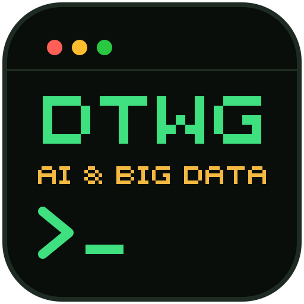
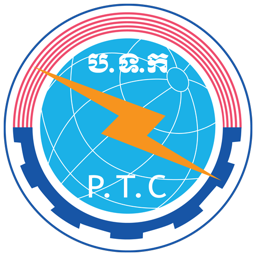

<div align="center">



# AI & Big Data

**Sub Working Group of the Digital Transformation Working Group (DTWG)**<br>
Ministry of Post and Telecommunications, Cambodia

<p>
  
  
  
  
  
</p>
<p>
  
  
  
</p>

[Live site](https://ai-dtwg.github.io) · [Team](https://ai-dtwg.github.io/#team) · [Projects](https://ai-dtwg.github.io/#projects) · [Contact](https://ai-dtwg.github.io/#contact)

</div>

## Overview

This repository holds the website of the AI & Big Data sub working group. The site looks and works like a terminal: visitors can type commands or tap the tabs to read about the group, its team, its projects and how to get in touch.

It is a static site. There is nothing to install and nothing to build. The one library it uses, three.js, is included in the repository.

## Features

- Terminal interface with command history, tab completion and clickable commands
- Sections for about, team, projects and contact, each with a direct link such as `/#team`
- Animated 3D background built with three.js, plus motion on the banner, cards and output
- Animation can be switched off with `fx off`, and stays off for visitors who prefer reduced motion
- Four color themes: green, amber, ice and paper
- Works on phones, tablets and desktops
- Khmer text set in the Khmer Digital typeface
- All content kept in one file

## Getting started

Clone the repository and serve the folder with any static file server.

```sh
git clone https://github.com/ai-dtwg/ai-dtwg.github.io.git
cd ai-dtwg.github.io
python3 -m http.server 8000
```

Then open <http://localhost:8000>.

## Project structure

```
.
├── index.html              Page shell
├── 404.html                Not found page
├── assets
│   ├── css/style.css       Themes and layout
│   ├── js/data.js          Site content
│   ├── js/terminal.js      Terminal behavior and commands
│   ├── js/scene.js         Animated 3D background
│   ├── vendor/three/       three.js r187 and its license
│   ├── img/                Logos
│   └── fonts/              Khmer Digital font files and license
└── README.md
```

## Editing content

All text on the site comes from [`assets/js/data.js`](assets/js/data.js). Edit that file to change:

| Section | Key in `data.js` |
| --- | --- |
| Group name, tagline and description | `group` |
| Parent organization and ministry | `org` |
| Expertise | `focus` |
| Lead, members and interns | `team` |
| Projects | `projects` |
| Contact details | `contact` |

Each team entry has a `group` of `lead`, `member` or `intern`, which decides the block it appears in. Empty fields are hidden.

Clicking a team card opens that member's full profile in a popup, with buttons, arrow keys and swipe to move to the next or previous member. The profile shows the optional `experience`, `education` and `work` lists and any links set on the entry.

## Commands

| Command | What it does |
| --- | --- |
| `help` | List commands |
| `about` | About the group |
| `team` | Who is on the team |
| `member <id>` | Show one team member in full |
| `projects` | What the group is working on |
| `project <id>` | Show one project |
| `contact` | Contact details |
| `all` | Show everything |
| `banner` | Show the banner |
| `theme [green\|amber\|ice\|paper]` | Change colors |
| `fx [on\|off]` | Turn animation on or off |
| `clear` | Clear the screen |

## Deployment

The site is published with GitHub Pages from the `main` branch. Every push to `main` goes live at <https://ai-dtwg.github.io> within a minute or two.

If the site does not update, check **Settings → Pages** and make sure the source is set to **Deploy from a branch**, `main`, `/ (root)`.

## Credits

- [Khmer Digital](https://github.com/pisey-suon/mptc-khmerDigitalFont) typeface by the Ministry of Post and Telecommunications, under the SIL Open Font License 1.1. See [`assets/fonts/OFL.txt`](assets/fonts/OFL.txt).
- [three.js](https://threejs.org) by the three.js authors, under the MIT License. See [`assets/vendor/three/LICENSE`](assets/vendor/three/LICENSE).
- The ministry emblem belongs to the Ministry of Post and Telecommunications of Cambodia.

<br>

<div align="center">

<a href="https://mptc.gov.kh"></a>

**Digital Transformation Working Group**<br>
Ministry of Post and Telecommunications

</div>
